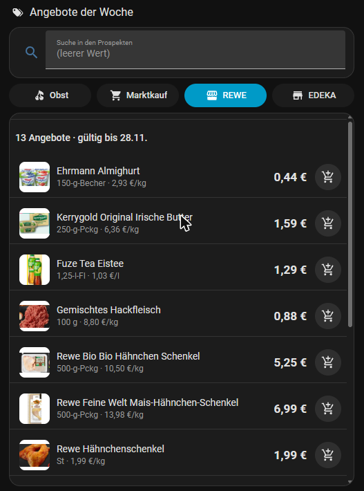
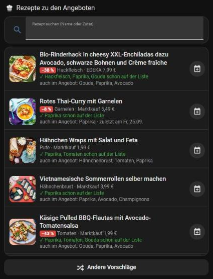
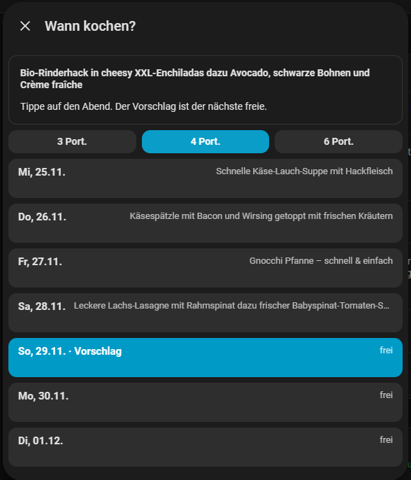
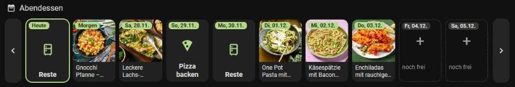

# Wochenkorb

[Deutsch](README.md) · **English**

The German README is the main one, this is its translation. The example cards, scripts and automations in `examples/` are in German on purpose: both sources only cover German brochures.

Home Assistant integration that turns the brochure offers of the week into the weekly shopping ("Wochenkorb" is German for weekly basket): offers as sensors and as a card, staples put on the shopping list automatically, optionally recipe suggestions from Mealie and a purchase history from receipts.

The offers come from the Marktguru search and from meinprospekt.de. For any search terms and a postal code, sensors with price, retailer, offer period, image and other details are created and updated hourly. New offers appear automatically, expired ones are removed, no restart required.

> **Unofficial hobby project.** Wochenkorb is not affiliated with, endorsed by or reviewed by Marktguru, meinprospekt or the retailers mentioned. The names are only used to identify the data sources. Both sources are unofficial and can change or stop working at any time.

## About this fork

Wochenkorb grew out of a fork of [thorschtn/ha-marktguru](https://github.com/thorschtn/ha-marktguru). All credit for the original integration goes there. The fork adds:

- **Editable settings.** Postal code, search terms and retailer filter can be changed under *Configure* without deleting the integration. The entry reloads itself and sensors of removed search terms are cleaned up.
- **Retailer filter.** Optional selection (for example Marktkauf, REWE, EDEKA); only offers of these retailers become sensors.
- **Second source: meinprospekt.de.** Covers retailers that Marktguru does not list for some regions (for example Marktkauf). It is queried every six hours with the Home Assistant home coordinates. Retailers already delivered by Marktguru are not added twice.
- **More attributes.** `source`, `link` (offer page or brochure page), `grundpreis` and `grundpreis_einheit` (price per kg or litre).
- **Free lists.** Under *Configure → Lists* search terms can be grouped into named lists (for example "Obst" or "Getränke"), each with its own icon and optional excluded words. Each list becomes its own tab of the offers card; its offers are shown there instead of under the retailer. The offer sensors carry the attributes `suchbegriff`, `liste` and `liste_ohne`, the sensor `sensor.wochenkorb_suchbegriffe_<zip>` the attribute `listen`.
- **Search sensor.** `sensor.wochenkorb_suche_<zip>` runs a live search in both sources for the text in the helper `input_text.angebote_suche` and returns the hits in its `results` attribute.
- **Optional: recipes from Mealie.** If the Mealie integration is set up, the option `mealie_recipes` adds a sensor with recipes whose main ingredient is on offer and the meal plan of the next days. Without Mealie nothing changes. See section 7.
- **Fixes.** Unloading the entry works, new offers create sensors during the hourly refresh, and the search-term sensor reports the number of terms instead of a string that could exceed 255 characters.

Like the original, this is a hobby project without support.

| Offers of the week | Recipes for the offers | Planning a recipe |
| --- | --- | --- |
|  |  |  |




# Upgrading from version 0.x (technical name `marktguru`)
Since version 1.0 the integration is called `wochenkorb` technically as well: folder `custom_components/wochenkorb`, entities `sensor.wochenkorb_…`, service `wochenkorb.add_purchases`. If you use an older version, remove the old entry and the folder `custom_components/marktguru`, set the integration up again and replace `marktguru_` with `wochenkorb_` in cards, scripts and automations. The purchase history is taken over on the first start.

# Known Issues
- None known for the search term list in this fork (fixed, see above).
- The search helper `input_text.angebote_suche` has to be created by hand (Settings → Devices & Services → Helpers → Text) if you want to use the search sensor.

# Installation & Configuration Guide
## 1. Requirements
Home Assistant (Core, OS, Supervised, or Container)
## 2. Installation
Manual Installation
- Download the repository from GitHub.
- Copy the wochenkorb folder into your Home Assistant directory:
- <config>/custom_components/wochenkorb
- Restart Home Assistant.
## 3. Configuration
Add the integration:
Go to
Settings → Devices & Services → Add Integration
Search for “Wochenkorb” and select it.

Fill in the configuration:

- Postal code:
The ZIP code for which you want to receive offers (e.g., 10115).
- Search terms:
List of products you want to monitor. Type a term and press Enter to add it, remove it with the cross.
- Retailers (optional):
Selection the offers are limited to; you can type your own names.
Finish:
After saving, the sensors are automatically created.
You can add as many instances of the integration as you like (e.g., for different ZIP codes or product lists).

## 4. Usage
Sensors:
For each found offer, a sensor like
sensor.wochenkorb_havana_rum_1_10115
is created, with attributes such as price, retailer, offer period, etc.
Automatic updates:
New offers appear automatically, expired ones are removed.
Multiple configurations:
You can monitor the same products for different ZIP codes.
## 5. Example Lovelace cards
The cards of this fork are in [`examples/`](examples/), see sections 6 to 8.

## 6. Example setup: offers and weekly staples

The folder [`examples/`](examples/) contains the setup this fork was built for. This part works without Mealie: an offers card with tabs and search, and an automation that puts weekly staples on a shopping list. Texts and article names are in German, adjust them to your household.

| File | What it does |
| --- | --- |
| `dashboard_template.yaml` | `button_card_templates` entries. `angebot_zeile` is one offer row (image, name, base price, discount badge, link to the offer, add-to-list button). `rezept_zeile` is only needed for the Mealie recipe card below and can be left out. Goes to the top level of the dashboard's raw configuration. |
| `dashboard_card.yaml` | The card: search field, one row of tabs with up to six free lists from the settings and the retailers (Marktkauf, REWE, EDEKA), all equally wide and wrapping when space runs out, scrolling offer lists sorted by discount, live search results. Tab and search text are kept per device. |
| `automation_grundartikel.yaml` | Every Thursday puts staples on the list in a per-article rhythm. If an offer is at least 15 % below the usual base price, the quantity is raised (stock-up) and the article is skipped until the stock is used up. "Fruit of the week" lists up to five offers from the free list "Obst". Offers it took over disappear from the card until the next run, and a push summary is sent if something new was added. |
| `automation_quellen_ueberwachen.yaml` | Daily notification if marktguru or meinprospekt delivers no offers. |
| `script_abgleich_wert_setzen.yaml` | Script to set usual price, rhythm and stock date per article, e.g. from receipts. |

Requirements:

- Frontend (HACS): [auto-entities](https://github.com/thomasloven/lovelace-auto-entities), [button-card](https://github.com/custom-cards/button-card), [card-mod](https://github.com/thomasloven/lovelace-card-mod)
- Helpers: `input_select.angebote_reiter` (options: the names of the lists and the retailers; the integration keeps them up to date on every start), `input_text.angebote_suche`, and, each with the maximum length of 255, `input_text.einkauf_vorrat`, `input_text.einkauf_preise`, `input_text.einkauf_rhythmus`, `input_text.einkauf_uebernommen`
- Per device (optional): `input_select.angebote_reiter_<id>` and `input_text.angebote_suche_<id>`, where `<id>` is the device's browser_mod id without the leading `browser_mod_`. This needs [browser_mod](https://github.com/thomasloven/hass-browser_mod). Reload the integration after creating the helpers, it adds one search sensor per search helper. Devices without their own helpers share the two general ones.
- A to-do list entity for the shopping list (here `todo.einkauf_bring` from the Bring! integration)

Replace before use: `GERAET_1` (browser_mod id of a device), `DEINE_PLZ` (your ZIP code, in lower case as part of the search sensor's entity id), `todo.einkauf_bring`, `notify.mobile_app_DEIN_HANDY`, the retailer names if you use other shops, and `start` plus the `artikel` list in the automation.

## 7. Optional: Mealie (recipes, week plan, shopping list)

Everything in this section is optional. Without the Mealie integration, leave the option `mealie_recipes` off and skip these files; the integration and the setup from section 6 work unchanged.

| File | What it does |
| --- | --- |
| `dashboard_card_wochenleiste.yaml` | Week strip: the next ten evenings as a row of tiles – recipe with picture, own entry with a matching icon, or still free. A tap on a recipe opens ingredients (converted to the planned portions) and steps with the buttons move, portions and remove; a tap on a free evening adds an own entry without a recipe. Arrows page by week: up to half a year back (view only) and eight weeks ahead. On narrow screens the row is swiped. Needs the helper `input_number.essen_woche` (−26 to 8, step 1), card-mod and the template `rezept_kachel` from `dashboard_template.yaml`. |
| `dashboard_card_rezepte.yaml` | Recipe card: five Mealie recipes that are not planned yet and whose main ingredient is on offer. A tap opens ingredients and steps in a popup, the calendar button asks for the evening and, if wanted, a larger number of portions, and plans the recipe. The button "Andere Vorschläge" shows other recipes; planned ones stay. A search field (helper `input_text.rezept_suche`) searches the whole Mealie collection by name or ingredient instead; the hits can be planned in the same way. |
| `dashboard_card_wochenplan.yaml` | Alternative to the week strip, as a plain list: the dinners of seven days from the Mealie meal plan, with arrows to page: up to half a year back (view only) and eight weeks ahead (to plan ahead; the recipe card then offers the evenings of the chosen week). Needs the helper `input_number.essen_woche` (−26 to 8, step 1). For today and later: a tap on a dish offers to move it to another evening, to change the portions or to remove it, a tap on a free evening an own entry without a recipe. |
| `script_rezept_einplanen.yaml` | Puts a recipe into the Mealie meal plan on the chosen evening and adds its ingredients to the Mealie shopping list, converted to the household size. Called without a date and with a browser_mod id it asks for the evening itself. |
| `script_rezept_ausplanen.yaml` | Removes a recipe from the meal plan again and takes its ingredients off the Mealie shopping list. |
| `script_essen_notieren.yaml`, `script_essen_notiz_entfernen.yaml` | Free entry without a recipe in the week plan (for example "pizza out"): a tap on a free evening opens a popup with quick choices and a text field. Needs the helper `input_text.essen_notiz`. |
| `script_rezept_zutaten.yaml` | Puts the ingredients of a recipe that is already on the meal plan (for example planned directly in Mealie) onto the shopping list. |
| `script_rezept_portionen.yaml` | Changes for how many portions a planned recipe is bought: unplans it and plans it again on the same day. |
| `script_rezept_verschieben.yaml` | Moves a planned recipe to another day. The shopping list stays as it is. |
| `automation_mealie_einkaufsliste_abgleich.yaml` | Keeps the Mealie shopping list and the real shopping list (here Bring!) in step: merges equal articles, adds up quantities, keeps notes you typed yourself and skips pantry articles. Independent of this integration, but the scripts above rely on it. |

Additional requirements:

- The [Mealie integration](https://www.home-assistant.io/integrations/mealie/) with its shopping list as a to-do entity
- [browser_mod](https://github.com/thomasloven/hass-browser_mod) for the popups
- Helpers: `input_button.rezepte_neu_mischen` (each press shows other suggestions) and `input_number.einkauf_portionen` (household size in portions, steps of 0.5; quantities of a recipe are converted from its servings when it is planned, counted things are rounded up to halves; 0 or no helper keeps the recipe quantities), `input_number.rezept_portionen_wahl` (0 to 12, steps of 0.5; holds the portions picked in the planning popup) and `input_text.einkauf_portionen_plan` (maximum length 255; remembers the portions per meal plan entry so that unplanning removes the same quantities)
- The options `mealie_recipes` and, to mark ingredients that are already on the list, `shopping_list` of this integration

Replace before use: `MEALIE_EINTRAG` (config entry id of the Mealie integration), `MEALIE_LISTE` (to-do entity of the Mealie shopping list), `DEINE_PLZ`, and `todo.mealie_to_bring` / `todo.einkauf_bring` in the sync automation.

### How the recipe suggestions work

With the option `mealie_recipes` the integration reads all recipes from the Mealie integration once a day, looks for main ingredients (meat, fish, cheese, vegetables; spices and staples do not count) and loads offers for the most frequent ones as up to 20 extra search terms. These do not create offer sensors. `sensor.wochenkorb_rezepte_<zip>` carries the dinners of the next eight days in the attribute `plan` and lists what is planned for the next 14 days (also without an offer) and below it recipes whose main ingredient is on offer (five new suggestions, the number can be set), best discount first, meat and fish weighted above cheese and vegetables. Meat and fish also count without a crossed-out price, with a fixed bonus, because an offer there usually saves more in euros than a high percentage on vegetables. The list is mixed: at first only one recipe per main ingredient, among the new suggestions one vegetarian recipe if one fits, and recipes that were not cooked for a while (Mealie's "last made") get a small bonus. Recipes from the meal plan of the last 14 days (can be set) are left out, recipes planned for the coming days always stay at the top and are marked as planned. The last day a recipe was on the meal plan is given as `last_cooked` on the suggestion and decides what counts as "not cooked for a while". Under Settings → Devices & services → Wochenkorb → Configure → "Recipes" you can set how many new suggestions there are, how many of them have to be without meat and fish (0 to all) and whether these slots are vegetarian or vegan. With the same number as the suggestions there are only such recipes. Vegetarian and vegan are detected from the ingredient texts (vegan: additionally no dairy, no egg, no honey), which can be wrong in single cases. The same step holds: excluded ingredients (recipes with these words in the name or the ingredients are not suggested, the search still finds them), the longest cooking time in minutes (recipes without a time stay in), for how many days a cooked recipe pauses (default 14), how much meat and fish count without a crossed-out price (not at all, normal, strong) and the quick choices for own entries in the week strip (attribute `schnellauswahl`). The whole meal plan that was read is in the attribute `kalender` (date → dinners, recipes with their picture); ingredients and steps of the recipes of the next three weeks are in the attribute `plan_details`. A press on `input_button.rezepte_neu_mischen` puts the current, unplanned suggestions aside and shows the next ones; when all have been shown it starts over. With the option `shopping_list` (a to-do entity, e.g. the Bring! list) main ingredients that are already on the list are marked. The planning script still adds all ingredients to the Mealie shopping list so that quantities can be summed up. Recipe images are copied to `www/wochenkorb_rezepte` so the card can show them without a Mealie login.

## 8. Optional: purchase history from receipts

The integration can keep a history of what was actually bought. It does not read receipts itself: something else (for example a scheduled assistant task that reads the e-receipts from the mailbox) delivers the positions through the service `wochenkorb.add_purchases`, one call per receipt. A receipt (time and retailer) is always replaced as a whole, so sending it twice does not duplicate anything. The history is stored locally in `.storage/wochenkorb_einkaeufe`.

One line per position, fields separated by semicolons:

```
bon;markt;bontext;artikel;gruppe;anzahl;menge;einheit;preis;grundartikel
2026-11-20 17:42;REWE;BIO E.WEIDEMILCH;Bio-H-Weidemilch;Molkerei & Eier;2;2;l;2,98;Milch
```

`menge` is the total quantity in `l`, `kg` or `stk` (empty if unknown), `preis` the amount paid for the line, `grundartikel` the staple of the weekly automation the position belongs to (or empty).

`sensor.einkauf_verlauf` (state: number of receipts) evaluates the history in its attributes:

- `monate`: spending per month, by retailer and by product group
- `grundartikel`: per staple the number of purchases, the buying rhythm in weeks and the usual base price (median of the last five purchases)
- `vorschlaege`: articles that are bought regularly but are not a staple
- `artikel`: the 80 most frequently bought articles with their last prices

| File | What it does |
| --- | --- |
| `script_kassenbon_speichern.yaml` | Wrapper around the service that can be exposed to Assist. |
| `automation_kassenbon_werte_lernen.yaml` | Passes rhythm and usual price of the staples to the staples automation (via `script_abgleich_wert_setzen.yaml`). |
| `dashboard_view_auswertung.yaml` | Dashboard view: spending per month, product groups, staples, suggestions and price history. |

