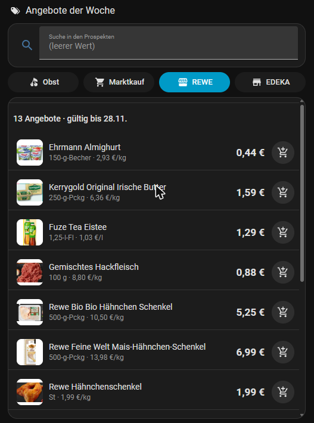
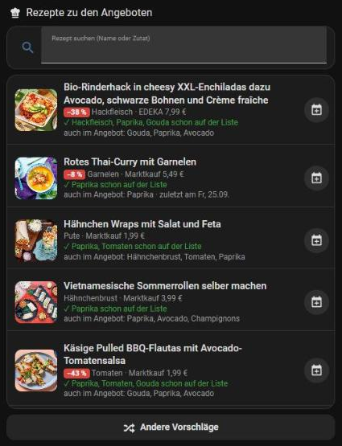
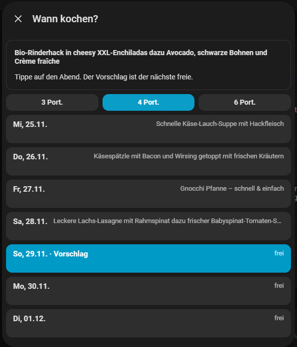

# Wochenkorb

**Deutsch** · [English](README.en.md)

Home-Assistant-Integration, die aus den Prospekt-Angeboten der Woche den Einkauf macht: Angebote als Sensoren und als Karte, Grundartikel automatisch auf der Einkaufsliste, auf Wunsch Rezeptvorschläge aus Mealie und ein Einkaufsverlauf aus Kassenbons.

Die Angebote kommen aus der Suche von Marktguru und von meinprospekt.de. Für beliebige Suchbegriffe und eine Postleitzahl entstehen Sensoren mit Preis, Händler, Gültigkeit, Bild und weiteren Angaben; sie werden stündlich aktualisiert. Neue Angebote kommen von selbst dazu, abgelaufene verschwinden, ohne Neustart.

> **Inoffizielles Hobbyprojekt.** Wochenkorb ist nicht mit Marktguru, meinprospekt oder den genannten Händlern verbunden und wird von ihnen weder unterstützt noch geprüft. Die Namen dienen nur dazu, die Datenquellen zu bezeichnen. Beide Quellen sind inoffiziell und können sich jederzeit ändern oder ausfallen.

| Angebote der Woche | Rezepte zu den Angeboten | Rezept einplanen |
| --- | --- | --- |
|  |  |  |

## Über diesen Fork

Wochenkorb ist aus einem Fork von [thorschtn/ha-marktguru](https://github.com/thorschtn/ha-marktguru) entstanden; die ursprüngliche Integration stammt von dort. Der Fork ergänzt:

- **Einstellungen änderbar.** Postleitzahl, Suchbegriffe und Händlerfilter lassen sich unter *Konfigurieren* ändern, ohne die Integration zu löschen. Suchbegriffe und Händler sind Listen, in denen sich einzelne Einträge hinzufügen und entfernen lassen. Der Eintrag lädt sich neu, Sensoren entfernter Suchbegriffe werden aufgeräumt.
- **Händlerfilter.** Optionale Auswahl (zum Beispiel Marktkauf, REWE, EDEKA); nur Angebote dieser Händler werden zu Sensoren.
- **Zweite Quelle: meinprospekt.de.** Deckt Händler ab, die Marktguru in manchen Regionen nicht führt (zum Beispiel Marktkauf). Sie wird alle sechs Stunden mit den Heimkoordinaten von Home Assistant abgefragt. Händler, die Marktguru schon liefert, kommen nicht doppelt.
- **Mehr Attribute.** `source`, `link` (Angebots- oder Prospektseite), `grundpreis` und `grundpreis_einheit` (Preis je Kilogramm oder Liter).
- **Freie Listen.** Unter *Konfigurieren → Listen* lassen sich Suchbegriffe zu benannten Listen zusammenfassen (zum Beispiel „Obst“ oder „Getränke“), jede mit eigenem Symbol und optionalen Ausschlusswörtern. Jede Liste wird ein eigener Reiter der Angebotskarte; ihre Angebote stehen dort statt beim Händler. Die Angebotssensoren tragen dafür die Attribute `suchbegriff`, `liste` und `liste_ohne`, der Sensor `sensor.wochenkorb_suchbegriffe_<plz>` das Attribut `listen`.
- **Such-Sensor.** `sensor.wochenkorb_suche_<plz>` sucht live in beiden Quellen nach dem Text im Helfer `input_text.angebote_suche` und liefert die Treffer im Attribut `results`.
- **Optional: Rezepte aus Mealie.** Ist die Mealie-Integration eingerichtet, liefert die Option `mealie_recipes` einen Sensor mit Rezepten, deren Hauptzutat im Angebot ist, und dem Essensplan der nächsten Tage. Ohne Mealie ändert sich nichts. Siehe Abschnitt 6.
- **Optional: Einkaufsverlauf aus Kassenbons.** Ein Dienst speichert Bonpositionen lokal, ein Sensor wertet sie aus. Siehe Abschnitt 7.
- **Korrekturen.** Das Entladen des Eintrags funktioniert, neue Angebote erzeugen ihre Sensoren bei der stündlichen Aktualisierung, und der Suchbegriff-Sensor meldet die Anzahl der Begriffe statt eines Textes, der länger als 255 Zeichen werden konnte.

Wie das Original ist dies ein Hobbyprojekt ohne Support. Große Teile des Codes sind mit KI-Unterstützung entstanden.

### Umstieg von Version 0.x (technischer Name `marktguru`)

Seit Version 1.0 heißt die Integration auch technisch `wochenkorb`: Ordner `custom_components/wochenkorb`, Entitäten `sensor.wochenkorb_…`, Dienst `wochenkorb.add_purchases`. Wer eine ältere Fassung nutzt, löscht den alten Eintrag und den Ordner `custom_components/marktguru`, richtet die Integration neu ein und ersetzt in Karten, Skripten und Automationen `marktguru_` durch `wochenkorb_`. Der Einkaufsverlauf wird beim ersten Start übernommen.

## 1. Voraussetzungen

Home Assistant (Core, OS, Supervised oder Container).

## 2. Installation

- Repository von GitHub herunterladen.
- Den Ordner `custom_components/wochenkorb` nach `<config>/custom_components/wochenkorb` kopieren.
- Home Assistant neu starten.

## 3. Einrichtung

Unter Einstellungen → Geräte & Dienste → Integration hinzufügen nach „Wochenkorb“ suchen.

- **Postleitzahl:** die PLZ, für die Angebote gesucht werden (zum Beispiel 10115).
- **Suchbegriffe:** Liste der Produkte, zum Beispiel Butter, Hackfleisch, Pepsi. Begriff eintippen und mit Enter hinzufügen, mit dem Kreuz wieder entfernen.
- **Händler (optional):** Auswahl, auf die die Angebote beschränkt werden; eigene Namen lassen sich dazutippen.
- **Rezepte aus Mealie** und **Einkaufsliste (optional):** siehe Abschnitt 6.

Nach dem Speichern entstehen die Sensoren von selbst. Die Integration lässt sich mehrfach einrichten, etwa für verschiedene Postleitzahlen.

Für den Such-Sensor muss der Helfer `input_text.angebote_suche` von Hand angelegt werden (Einstellungen → Geräte & Dienste → Helfer → Text).

## 4. Verwendung

Für jedes gefundene Angebot entsteht ein Sensor wie `sensor.wochenkorb_butter_1_10115` mit Attributen wie Preis, Händler und Gültigkeit. Neue Angebote erscheinen von selbst, abgelaufene werden entfernt.

## 5. Beispiel-Einrichtung: Angebote und wöchentliche Grundartikel

Der Ordner [`examples/`](examples/) enthält die Einrichtung, für die dieser Fork gebaut wurde. Dieser Teil funktioniert ohne Mealie: eine Angebotskarte mit Reitern und Suche und eine Automation, die wöchentliche Grundartikel auf eine Einkaufsliste setzt. Artikelnamen und Mengen sind Beispiele und an den eigenen Haushalt anzupassen.

| Datei | Zweck |
| --- | --- |
| `dashboard_template.yaml` | Einträge für `button_card_templates`. `angebot_zeile` ist eine Angebotszeile (Bild, Name, Grundpreis, Rabatt, Link zum Angebot, Knopf „auf die Liste“). `rezept_zeile` wird nur für die Rezeptkarte aus Abschnitt 6 gebraucht. Kommt auf die oberste Ebene der Dashboard-Konfiguration (Raw-Editor). |
| `dashboard_card.yaml` | Die Karte: Suchfeld, eine Reiterzeile mit bis zu sechs freien Listen aus den Einstellungen und den Händlern (Marktkauf, REWE, EDEKA), alle gleich breit und bei Platzmangel umbrechend, scrollende Angebotslisten nach Rabatt sortiert, Live-Suchergebnisse. Reiter und Suchtext werden je Gerät gemerkt. |
| `automation_grundartikel.yaml` | Setzt jeden Donnerstag Grundartikel im eigenen Rhythmus je Artikel auf die Liste. Liegt ein Angebot mindestens 15 % unter dem üblichen Grundpreis, wird die Menge erhöht (Vorrat) und der Artikel pausiert, bis der Vorrat aufgebraucht ist. „Obst der Woche“ nennt bis zu fünf Angebote aus der freien Liste „Obst“. Übernommene Angebote verschwinden bis zum nächsten Lauf aus der Karte; kam etwas Neues auf die Liste, geht eine Zusammenfassung aufs Handy. |
| `automation_quellen_ueberwachen.yaml` | Tägliche Meldung, wenn marktguru oder meinprospekt keine Angebote liefert. |
| `script_abgleich_wert_setzen.yaml` | Setzt üblichen Preis, Rhythmus und Vorratsdatum je Artikel, zum Beispiel aus Kassenbons. |

Voraussetzungen:

- Frontend (HACS): [auto-entities](https://github.com/thomasloven/lovelace-auto-entities), [button-card](https://github.com/custom-cards/button-card), [card-mod](https://github.com/thomasloven/lovelace-card-mod)
- Helfer: `input_select.angebote_reiter` (Optionen: die Namen der Listen und der Händler; die Integration hält sie bei jedem Start aktuell), `input_text.angebote_suche` und, jeweils mit maximaler Länge 255, `input_text.einkauf_vorrat`, `input_text.einkauf_preise`, `input_text.einkauf_rhythmus`, `input_text.einkauf_uebernommen`
- Je Gerät (optional): `input_select.angebote_reiter_<id>` und `input_text.angebote_suche_<id>`, wobei `<id>` die browser_mod-Kennung des Geräts ohne das führende `browser_mod_` ist. Das braucht [browser_mod](https://github.com/thomasloven/hass-browser_mod). Nach dem Anlegen der Helfer die Integration neu laden; sie legt je Such-Helfer einen Such-Sensor an. Geräte ohne eigene Helfer teilen sich die beiden allgemeinen.
- Eine To-do-Liste als Einkaufsliste (hier `todo.einkauf_bring` aus der Bring!-Integration)

Vor dem Einsatz ersetzen: `GERAET_1` (browser_mod-Kennung eines Geräts), `DEINE_PLZ` (die eigene PLZ, als Teil der Entitäts-ID des Such-Sensors), `todo.einkauf_bring`, `notify.mobile_app_DEIN_HANDY`, die Händlernamen bei anderen Märkten sowie `start` und die Liste `artikel` in der Automation.

## 6. Optional: Mealie (Rezepte, Wochenplan, Einkaufsliste)

Alles in diesem Abschnitt ist optional. Ohne die Mealie-Integration bleibt die Option `mealie_recipes` aus und diese Dateien werden übersprungen; die Integration und die Einrichtung aus Abschnitt 5 funktionieren unverändert.

| Datei | Zweck |
| --- | --- |
| `dashboard_card_rezepte.yaml` | Rezeptkarte: bis zu fünf Mealie-Rezepte, deren Hauptzutat im Angebot ist. Ein Tipp öffnet Zutaten und Zubereitung, der Kalender-Knopf fragt nach dem Abend und auf Wunsch nach einer größeren Portionenzahl und plant das Rezept ein. Der Knopf „Andere Vorschläge“ zeigt andere Rezepte; Eingeplantes bleibt stehen. |
| `dashboard_card_wochenplan.yaml` | Die Abendessen der nächsten sieben Tage aus dem Mealie-Essensplan; ein Tipp auf ein Gericht bietet an, es zu verschieben, die Portionen zu ändern oder es vom Plan zu nehmen, ein Tipp auf einen freien Abend einen eigenen Eintrag ohne Rezept. |
| `script_rezept_einplanen.yaml` | Trägt ein Rezept am gewählten Abend in den Essensplan ein und legt seine Zutaten, umgerechnet auf die Portionenzahl, auf die Mealie-Einkaufsliste. Ohne Datum und mit browser_mod-Kennung fragt es selbst nach dem Abend. |
| `script_rezept_ausplanen.yaml` | Nimmt ein Rezept wieder vom Plan und seine Zutaten von der Mealie-Einkaufsliste. |
| `script_essen_notieren.yaml`, `script_essen_notiz_entfernen.yaml` | Freier Eintrag ohne Rezept im Wochenplan (zum Beispiel „Pizza auswärts“): ein Tipp auf einen freien Abend öffnet ein Fenster mit Schnellauswahl und Textfeld. Braucht den Helfer `input_text.essen_notiz`. |
| `script_rezept_portionen.yaml` | Ändert, für wie viele Portionen eines eingeplanten Rezepts eingekauft wird: nimmt es vom Plan und plant es am selben Tag neu ein. |
| `script_rezept_verschieben.yaml` | Legt ein eingeplantes Rezept auf einen anderen Tag. Die Einkaufsliste bleibt unverändert. |
| `automation_mealie_einkaufsliste_abgleich.yaml` | Hält die Mealie-Einkaufsliste und die eigentliche Einkaufsliste (hier Bring!) im Gleichschritt: legt gleiche Artikel zusammen, summiert Mengen, behält selbst getippte Notizen und überspringt Vorratsartikel. Unabhängig von dieser Integration, aber die Skripte oben bauen darauf auf. |

Zusätzliche Voraussetzungen:

- Die [Mealie-Integration](https://www.home-assistant.io/integrations/mealie/) mit ihrer Einkaufsliste als To-do-Entität
- [browser_mod](https://github.com/thomasloven/hass-browser_mod) für die Fenster
- Helfer:
  - `input_button.rezepte_neu_mischen`: jeder Druck zeigt andere Vorschläge
  - `input_number.einkauf_portionen`: Haushaltsgröße in Portionen, Schritte von 0,5. Beim Einplanen werden die Mengen eines Rezepts von seiner Portionsangabe umgerechnet, Gezähltes wird auf halbe Stück aufgerundet; 0 oder kein Helfer lässt die Mengen wie im Rezept.
  - `input_number.rezept_portionen_wahl`: 0 bis 12, Schritte von 0,5; hält die im Fenster gewählte Portionenzahl
  - `input_text.einkauf_portionen_plan`: maximale Länge 255; merkt die Portionen je Planeintrag, damit das Ausplanen dieselben Mengen wieder abzieht
- Die Optionen `mealie_recipes` und, um schon vorhandene Zutaten zu markieren, `shopping_list` dieser Integration

Vor dem Einsatz ersetzen: `MEALIE_EINTRAG` (ID des Konfigurationseintrags der Mealie-Integration), `MEALIE_LISTE` (To-do-Entität der Mealie-Einkaufsliste), `DEINE_PLZ` sowie `todo.mealie_to_bring` / `todo.einkauf_bring` in der Abgleich-Automation.

### So entstehen die Rezeptvorschläge

Mit der Option `mealie_recipes` liest die Integration einmal täglich alle Rezepte aus der Mealie-Integration, sucht darin Hauptzutaten (Fleisch, Fisch, Käse, Gemüse; Gewürze und Grundvorräte zählen nicht) und lädt für die häufigsten Angebote, als bis zu 20 zusätzliche Suchbegriffe. Diese erzeugen keine Angebotssensoren.

`sensor.wochenkorb_rezepte_<plz>` führt im Attribut `plan` die Abendessen der nächsten acht Tage und nennt bis zu fünf Rezepte, deren Hauptzutat im Angebot ist: bester Rabatt zuerst, Fleisch und Fisch höher gewichtet als Käse und Gemüse. Die Liste ist gemischt: zunächst nur ein Rezept je Hauptzutat, mindestens ein vegetarisches, wenn eines passt, und Rezepte, die länger nicht gekocht wurden (Mealies „zuletzt gekocht“), bekommen einen kleinen Bonus. Rezepte aus dem Essensplan der letzten 14 Tage bleiben außen vor; für die nächsten Tage Eingeplantes steht immer oben und ist markiert. Ein Druck auf `input_button.rezepte_neu_mischen` stellt die aktuellen, nicht eingeplanten Vorschläge zurück und zeigt die nächsten; sind alle gezeigt, beginnt es von vorn.

Mit der Option `shopping_list` (eine To-do-Entität, etwa die Bring!-Liste) werden Hauptzutaten markiert, die schon auf der Liste stehen. Das Einplan-Skript legt trotzdem alle Zutaten auf die Mealie-Einkaufsliste, damit sich die Mengen addieren lassen. Rezeptbilder werden nach `www/wochenkorb_rezepte` kopiert, damit die Karte sie ohne Mealie-Anmeldung zeigen kann.

## 7. Optional: Einkaufsverlauf aus Kassenbons

Die Integration kann festhalten, was tatsächlich gekauft wurde. Sie liest keine Bons selbst: Etwas anderes (zum Beispiel eine geplante Assistenten-Aufgabe, die die eBons aus dem Postfach liest) liefert die Positionen über den Dienst `wochenkorb.add_purchases`, ein Aufruf je Bon. Ein Bon (Zeitpunkt und Markt) wird immer als Ganzes ersetzt; ihn zweimal zu senden legt nichts doppelt an. Der Verlauf liegt lokal in `.storage/wochenkorb_einkaeufe`.

Eine Zeile je Position, Felder mit Semikolon getrennt:

```
bon;markt;bontext;artikel;gruppe;anzahl;menge;einheit;preis;grundartikel
2026-11-20 17:42;REWE;BIO E.WEIDEMILCH;Bio-H-Weidemilch;Molkerei & Eier;2;2;l;2,98;Milch
```

`menge` ist die Gesamtmenge in `l`, `kg` oder `stk` (leer, wenn unbekannt), `preis` der bezahlte Betrag der Zeile, `grundartikel` der Grundartikel der Wochen-Automation, zu dem die Position gehört (oder leer).

`sensor.einkauf_verlauf` (Zustand: Zahl der Bons) wertet den Verlauf in seinen Attributen aus:

- `monate`: Ausgaben je Monat, nach Markt und nach Warengruppe
- `grundartikel`: je Grundartikel die Zahl der Käufe, der Kaufrhythmus in Wochen und der übliche Grundpreis (Median der letzten fünf Käufe)
- `vorschlaege`: Artikel, die regelmäßig gekauft werden, aber kein Grundartikel sind
- `artikel`: die 80 am häufigsten gekauften Artikel mit ihren letzten Preisen

| Datei | Zweck |
| --- | --- |
| `script_kassenbon_speichern.yaml` | Hülle um den Dienst, die sich für Assist freigeben lässt. |
| `automation_kassenbon_werte_lernen.yaml` | Übergibt Rhythmus und üblichen Preis der Grundartikel an die Grundartikel-Automation (über `script_abgleich_wert_setzen.yaml`). |
| `dashboard_view_auswertung.yaml` | Dashboard-Ansicht: Ausgaben je Monat, Warengruppen, Grundartikel, Vorschläge und Preisverlauf. |
